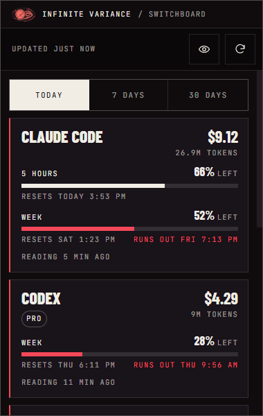

# IV Switchboard

A small Windows tray app from [Infinite Variance](https://infinitevariance.ai). It shows what's left on your own
Claude Code, Codex and Hermes, when each one resets, whether you'll run out before it does, and what each task used at
API prices.



## What it shows

- **What's left**: Claude Code's five-hour and weekly allowance, and Codex's weekly allowance, as bars that empty as
  you use them, with the reset time.
- **Run-out warning**: at your pace so far, whether a window runs out before it resets, and when.
- **What it used**: tokens and the API-equivalent cost for Today, 7 Days and 30 Days, per app, and your five
  biggest tasks. Hermes is split by provider, so you can see what drew on your Codex plan.
- **The tray tooltip**: the tightest windows at a glance, without opening anything.

Costs are what the same use would cost at Anthropic's, OpenAI's and xAI's published API prices. They are for
comparison only, not what your subscriptions charge.

## What it reads

Only files the apps already keep on your PC:

- Codex's session logs in `%USERPROFILE%\.codex`
- Claude Code's transcripts in `%USERPROFILE%\.claude`
- Hermes' usage records in `%LOCALAPPDATA%\hermes` (from a copy, so Hermes is never locked)

The formats are described in [docs/data-sources.md](docs/data-sources.md).

## What it never does

- It never sends your usage anywhere. The only thing it fetches from the internet is its own updates, from this
  repository's releases. The one exception is Refresh on the Claude card: it asks Claude Code to send Anthropic one
  short message, and only when you press it.
- It never reads or keeps your sign-ins.
- It never keeps the text of your prompts or replies. Tasks are named by their title or folder, and the eye button
  hides even those for screenshots.
- It never changes Codex or Hermes, and changes Claude Code's settings only when you press Connect Claude.
- It never pools or switches accounts. Sharing or rotating subscription logins breaks the providers' terms, so
  IV Switchboard just shows each of your own accounts as it is.

## Install

Download `IV-Switchboard-Setup.exe` from the [latest release](https://github.com/hollisorg/iv-switchboard/releases/latest)
and run it. It installs for your Windows user only and adds IV Switchboard to the Start menu. The installer isn't
code-signed yet, so Windows may show "Windows protected your PC": choose More info, then Run anyway.

IV Switchboard lives in the tray (the arrow by the clock). Click its icon to open it; right-click for Scan now, Open at
login and Quit. An installed copy updates itself: it downloads new versions in the background and installs them when
you press Restart to update or quit.

Start it yourself, from the Start menu or File Explorer. An app started from inside the Claude desktop app has its
files redirected into Claude's own storage, where Claude Code's status line can't find them.

## Connect Claude (optional)

Claude Code only tells a status line how much of your five-hour and weekly allowance is used. Connect Claude adds a
small status line to `%USERPROFILE%\.claude\settings.json` so the meter can show it. It backs the file up first and
changes only that one setting. If you already had a status line, yours still shows: IV Switchboard runs it for you.
Disconnect puts the file back exactly as it was. Connect Claude needs Node.js, which Claude Code users normally have.

The reading refreshes whenever you use Claude Code in a terminal. The Claude desktop app's Code tab doesn't run status
lines, so once you've worked there since the last reading the card fades the bars, marks them out of date and counts the
replies since.

## Refresh Claude

The Refresh button on the Claude card reads your allowance on the spot, with or without Connect. It runs Claude Code in
the background with no window (`claude -p` on Haiku, one turn, no saved session) and keeps only the five-hour and
weekly figures Claude Code reports. The reply is thrown away. Each press uses one short Haiku message from your
allowance, so it only runs when you press it. It needs Claude Code installed and signed in to a Pro, Max or Ultra plan;
Claude Code uses its own sign-in, and IV Switchboard never sees it. Any SessionStart hooks in your Claude settings run
too, as they would when you start Claude Code.

## Uninstall

Press Disconnect first if you connected Claude, then uninstall from Windows Settings. Your usage history stays in
`%APPDATA%\IV Switchboard` until you delete that folder.

## Build it yourself

Needs Node.js 24 or newer (for `node:sqlite`) on Windows.

```bash
npm install
npm test
npm run build
npm run dist
```

`npm run dist` writes the installer to `dist\`. `node scripts/ui-check.mjs qa/ui-check` opens the app on made-up demo
data and checks the popover; `node scripts/live-read.mjs` runs one scan of your real folders into a throwaway store and
prints numbers only.

## Credits

The idea came from [codex-switch](https://github.com/joshp123/codex-switch). IV Switchboard is a separate app with no
code taken from it, and it leaves out codex-switch's account pooling. Open-source parts and fonts are listed in
[THIRD_PARTY_NOTICES.txt](THIRD_PARTY_NOTICES.txt).

IV Switchboard is not made by or affiliated with Anthropic, OpenAI, xAI or Nous Research.

## License

[MIT](LICENSE) © 2026 Infinite Variance

## Signed Windows release builds

Run `npm run dist:win-release` on Windows to stage a signed installer, blockmap, and updater
manifest in `dist/`. Use the Hollis Azure tenant in Azure CLI, with the .NET 10 x64 runtime
and Windows SDK 22621 or newer installed. The release build checks the publisher, timestamp,
and updater checksum before it succeeds. `npm run dist` is for unsigned development builds.
